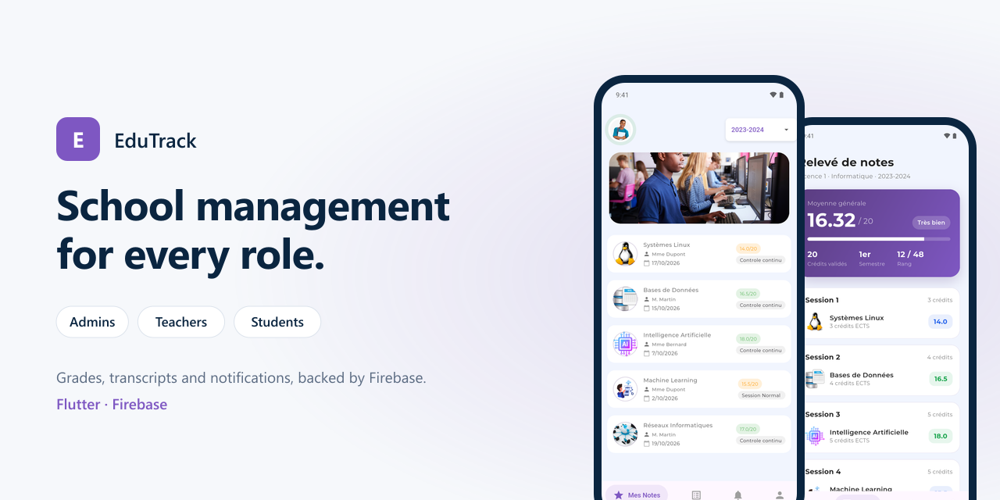
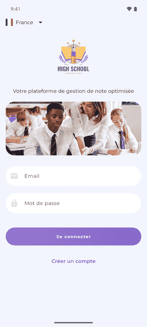
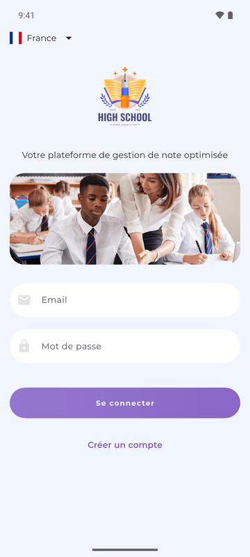
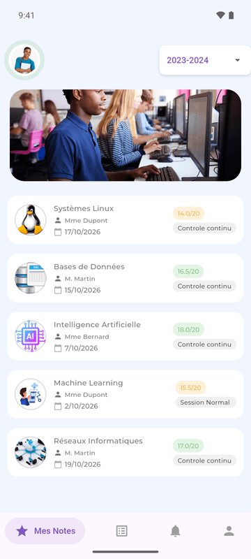
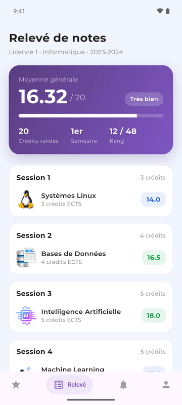
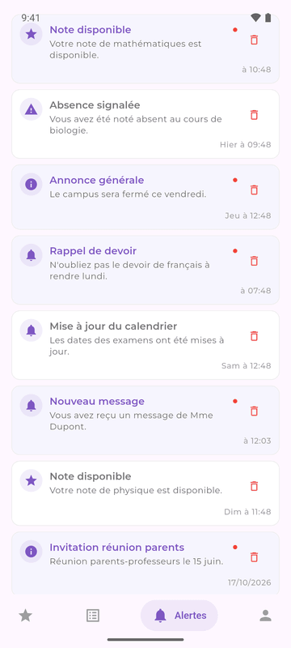
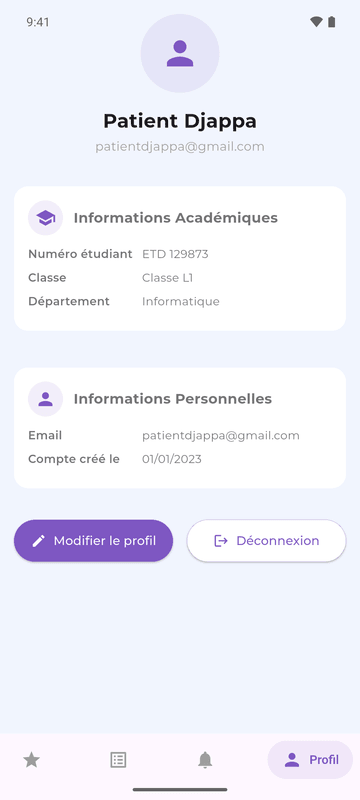

# EduTrack

<p align="center"></p>


A school management app for administrators, teachers and students: grades, transcripts and notifications, backed by Firebase.

## Screens

<p align="center"></p>

| Sign in | Grades | Transcript | Notifications | Profile |
|:---:|:---:|:---:|:---:|:---:|
|  |  |  |  |  |

## Features

**Administrators**
- Overview of students and teachers, with their details.
- Admin sign-up protected by a passphrase.
- Notifications to users.

**Teachers**
- Grade entry per subject and session.
- Import of grade files (Excel or CSV).
- Reports, notifications and profile.

**Students**
- Grades per subject, with assessment type and date.
- Transcript: overall average, credits, rank, results per session.
- Notifications when new grades are published.

**Across the app**
- Firebase Authentication with role-based routing.
- Push notifications (Firebase Cloud Messaging and local notifications).
- Welcome email on account creation.
- Phone number field with country selection, using [flutter_flag_selector](https://pub.dev/packages/flutter_flag_selector), my own package.

## Tech stack

- Flutter, Dart, Provider
- Firebase: Authentication, Cloud Firestore, Storage, Cloud Messaging, App Check
- [file_picker](https://pub.dev/packages/file_picker), [share_plus](https://pub.dev/packages/share_plus), [flutter_local_notifications](https://pub.dev/packages/flutter_local_notifications), [salomon_bottom_bar](https://pub.dev/packages/salomon_bottom_bar), [mailer](https://pub.dev/packages/mailer)

```
lib/
├── models/       users, grades, subjects…
├── services/     auth, Firestore, files, notifications, email
├── wrappers/     role-based routing after sign-in
├── screens/
│   ├── auth/     sign in, sign up
│   ├── admin/
│   ├── teacher/
│   └── student/
└── ui/           reusable widgets and controllers
```

Firestore collections: `users`, `classes`, `subjects`, `sessions`, `grades`, `notifications`, `reports`, `admin_logs`.

## Getting started

1. Create a Firebase project and enable Authentication (email and password), Cloud Firestore, Storage and Cloud Messaging.
2. Register the Android app and replace `android/app/google-services.json` with yours (and add `ios/Runner/GoogleService-Info.plist` for iOS).
3. Run:

```bash
flutter pub get
flutter run
```

## License

MIT, see [LICENSE](LICENSE).

## Author

**Dissang Kevin** · Mobile AI Engineer
[Portfolio](https://dissangkevin.work) · [GitHub](https://github.com/kteken10)
